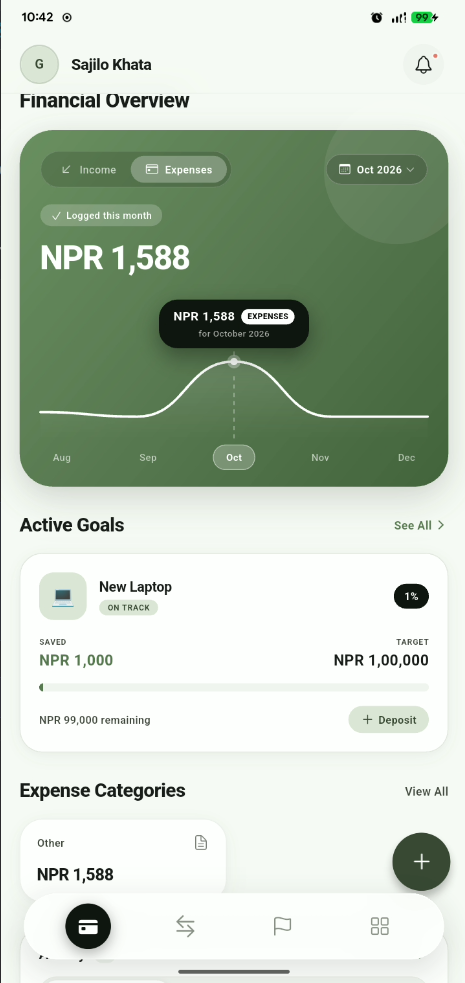
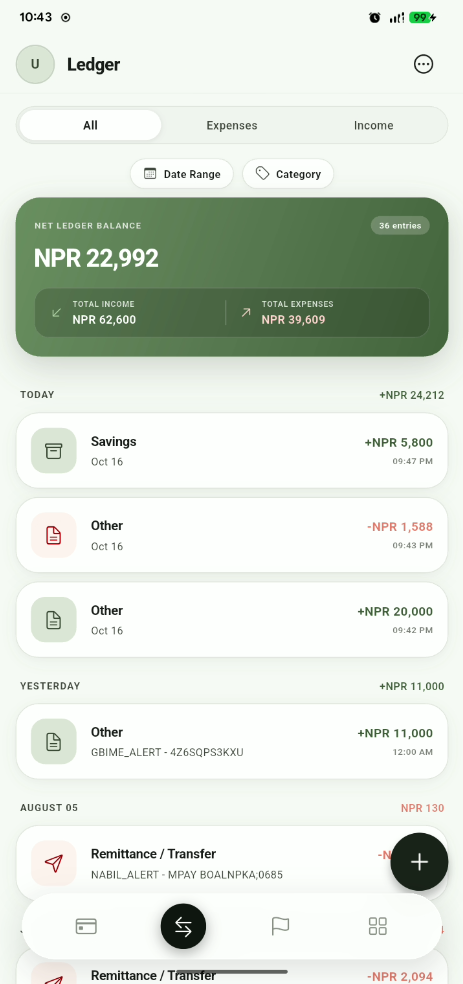
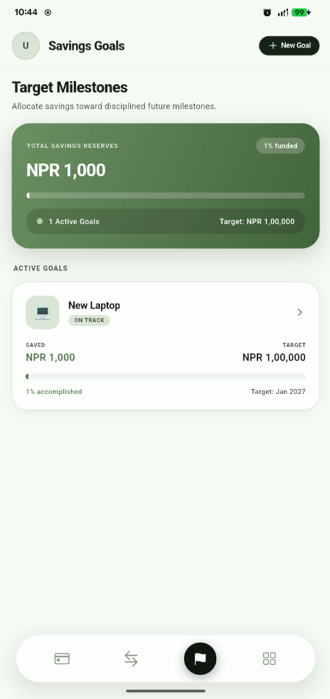
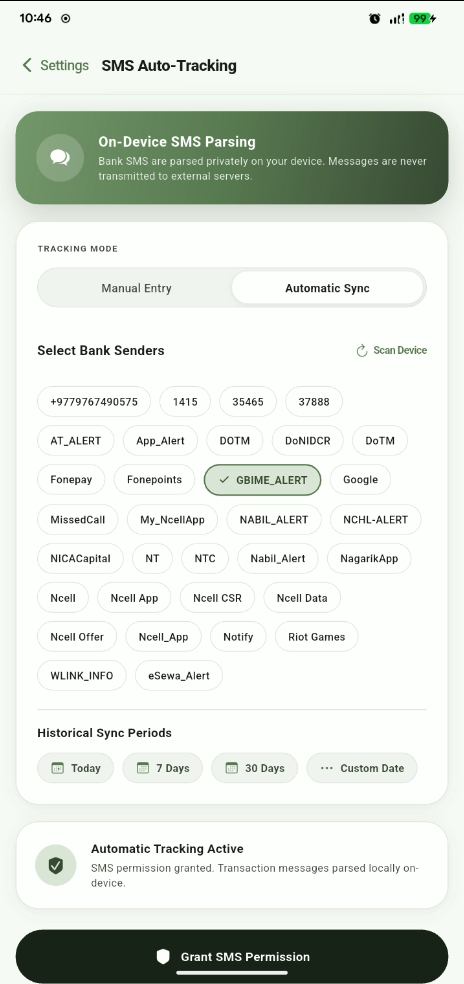
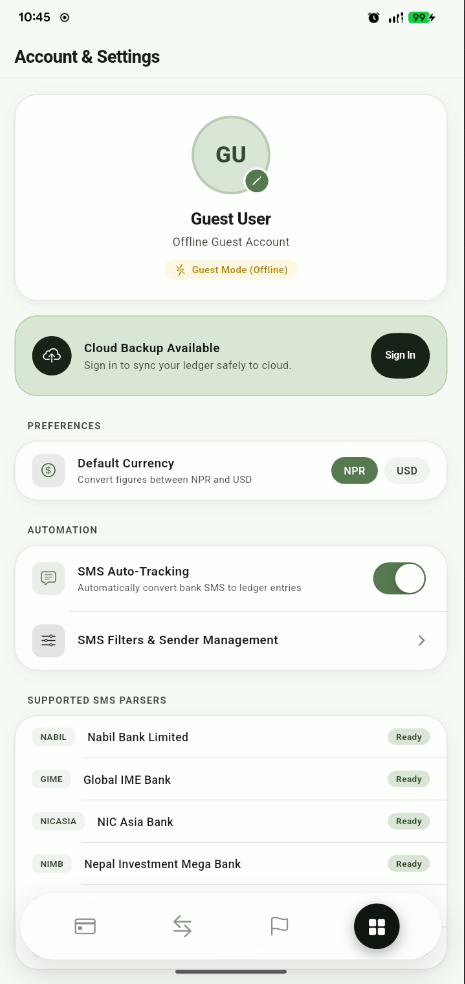
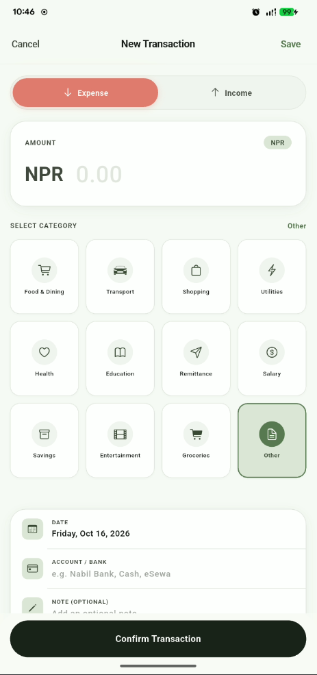

# Sajilo Khata

### Nepal's Smartest Expense Tracker

Automatically reads your bank SMS and logs every transaction.
Set savings goals, visualize your spending, and take full control of your money — all in Nepali Rupees.

---

## What is Sajilo Khata?

Sajilo Khata is a personal finance app built specifically for Nepal. It reads your bank SMS messages and automatically logs income and expenses — no manual entry required. Whether you're tracking daily spending or saving for a big goal, Sajilo Khata keeps everything organized so you don't have to.

> **"Track Every Rupee. Automatically."**

---

## Screenshots

| Dashboard | Transactions | Savings Goals |
|:---:|:---:|:---:|
|  |  |  |

| SMS Tracking | Profile | Add Transaction |
|:---:|:---:|:---:|
|  |  |  |

---

## Features

### SMS Auto-Reader
Just install the app and grant SMS permission. Sajilo Khata automatically reads bank transaction messages and logs them as income or expenses. No typing, no forgetfulness — it just works.

### Smart Dashboard
See your complete financial picture at a glance. Monthly income, expenses, and net balance displayed with clean, interactive charts. Know exactly where your money goes.

### Savings Goals
Set a target amount and deadline. Sajilo Khata calculates how much you need to save each day and tracks your progress. Celebrate when you hit your goal.

### Transaction Ledger
Every transaction in one place. Filter by bank, category, date, or type. Credits in green, debits in red. Search anything instantly.

### Offline-First
Works without internet. Your data is stored locally using Hive. When you're back online, everything syncs to Firebase automatically.

### Secure & Private
Your financial data lives under your Google account. Firebase security rules ensure no one else can access it. SMS processing happens on-device — raw messages are never sent to any server.

### Export & Share
Need to share your expenses with an accountant or family member? Export everything as a CSV file and share via any app.

### Smart Notifications
Get notified when a transaction is auto-logged, when you're approaching a budget limit, or when you've achieved a savings goal.

---

## Supported Banks

Sajilo Khata's SMS parser works with major Nepali banks and digital wallets:

| Bank | Status |
|---|---|
| NIMB | Supported |
| NIC Asia | Supported |
| ADB | Supported |
| Nabil Bank | Supported |
| Laxmi Sunrise | Supported |

*Don't see your bank? Open an issue and we'll add support.*

---

## Built with

| Layer | Technology |
|---|---|
| **App** | Flutter (Dart) |
| **Local DB** | Hive |
| **Cloud Sync** | Firebase Firestore |
| **Auth** | Firebase Authentication (Google Sign-In) |
| **Notifications** | Firebase Cloud Messaging |
| **Crash Reporting** | Firebase Crashlytics |

*This repository contains the marketing website, built with Next.js, React, and Tailwind CSS.*

---

## Links

| | |
|---|---|
| Play Store | [Download Sajilo Khata](https://play.google.com/store/apps/details?id=com.sajilokhata) |
| Website | [sajilokhata.gambhirpoudel.com.np](https://sajilokhata.gambhirpoudel.com.np) |
| Privacy Policy | [Read Privacy Policy](https://sajilokhata.gambhirpoudel.com.np/privacy-policy) |
| Terms of Service | [Read Terms](https://sajilokhata.gambhirpoudel.com.np/terms-of-service) |

---

## Developer

Built by **Gambhir Poudel** at [RedPixel Labs](https://gambhirpoudel.com.np)

---

**[Download Now on Play Store](https://play.google.com/store/apps/details?id=com.sajilokhata)**

*Made with care in Nepal*

